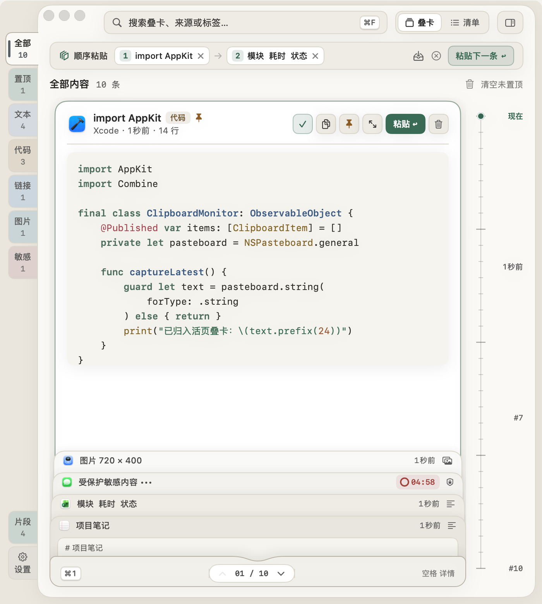
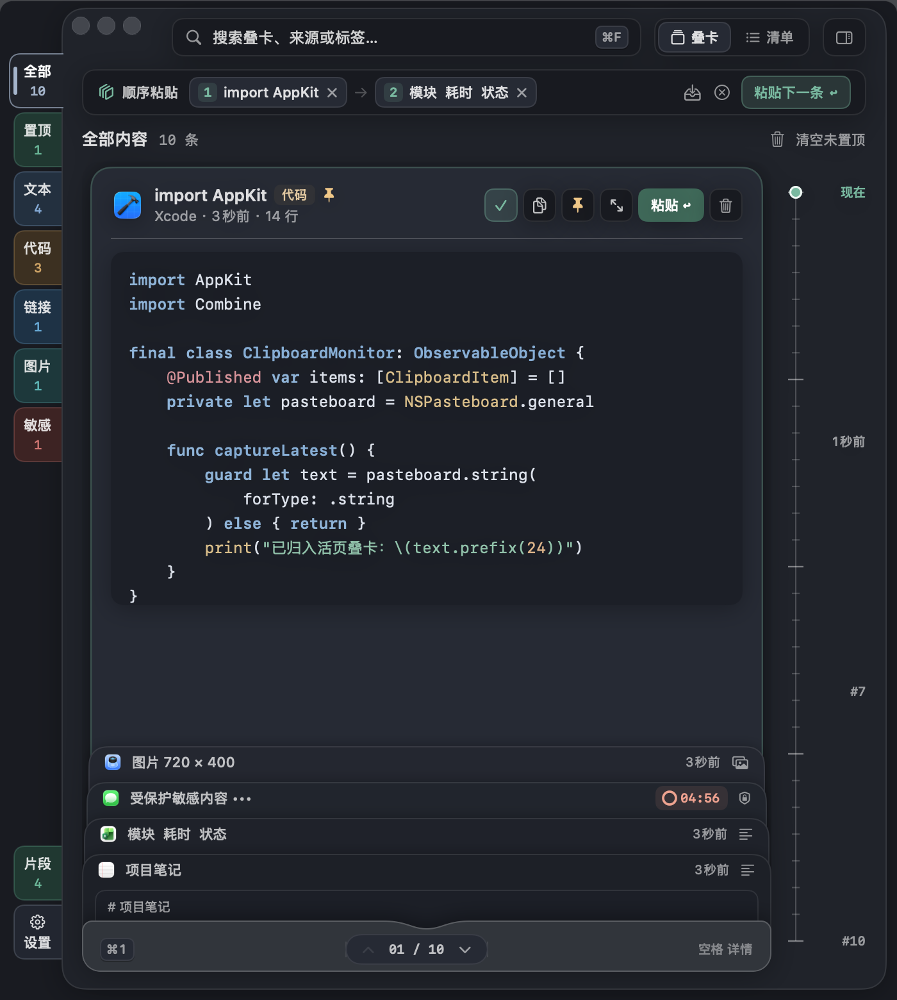
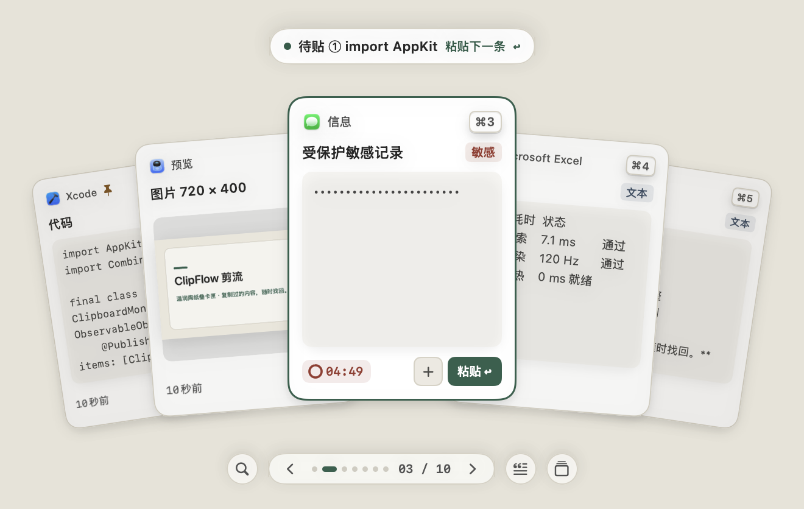
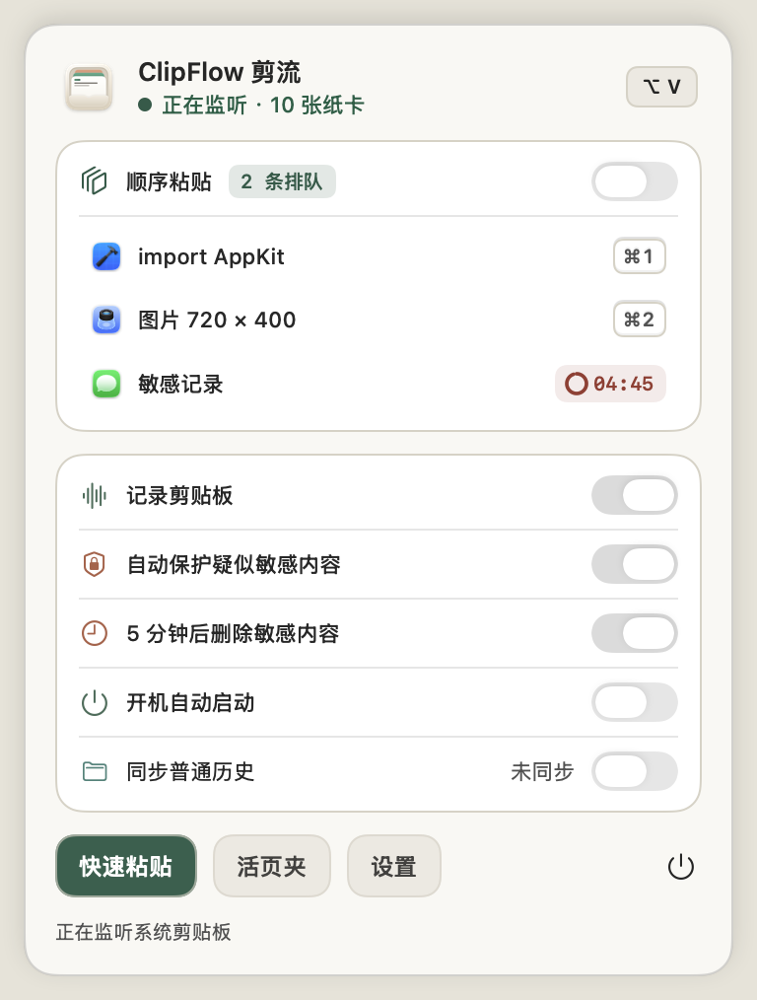
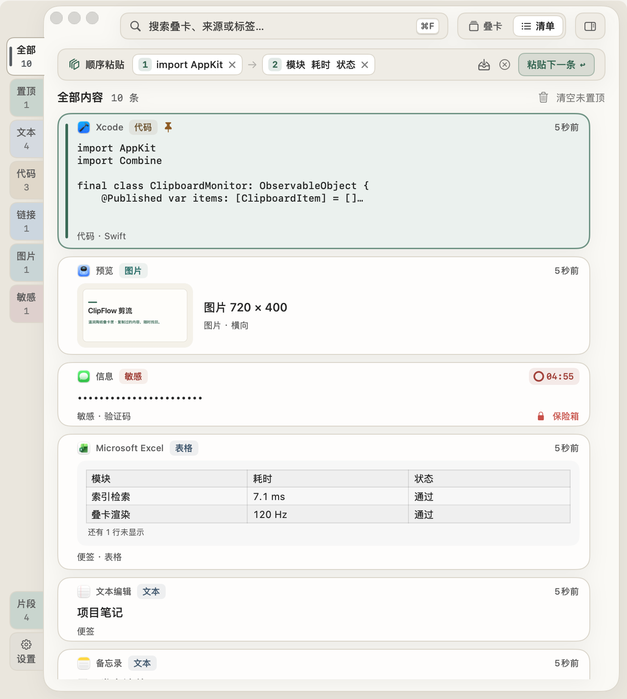
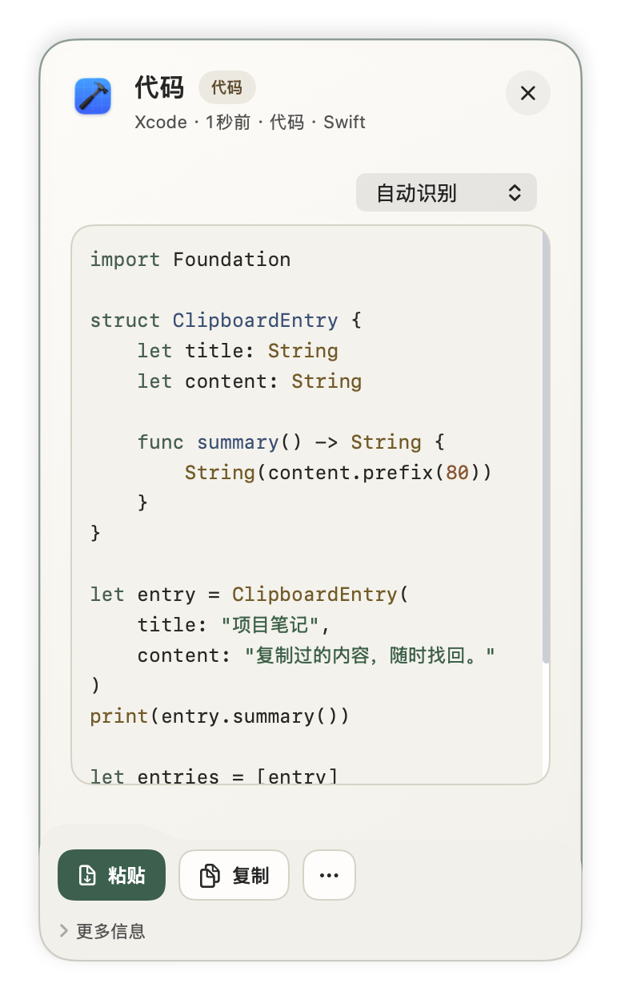
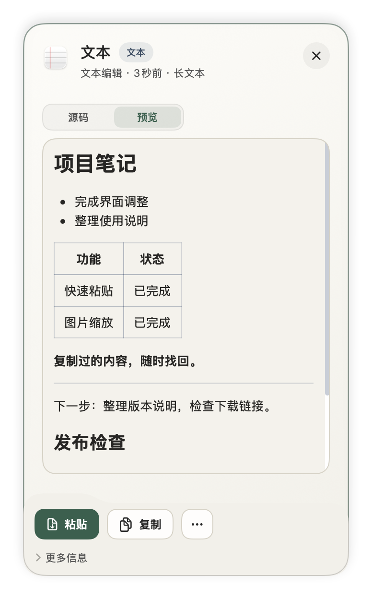
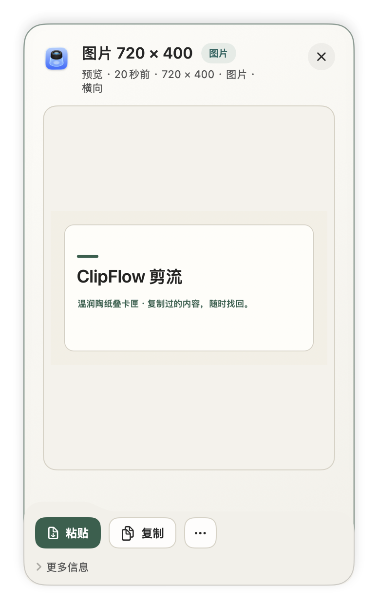
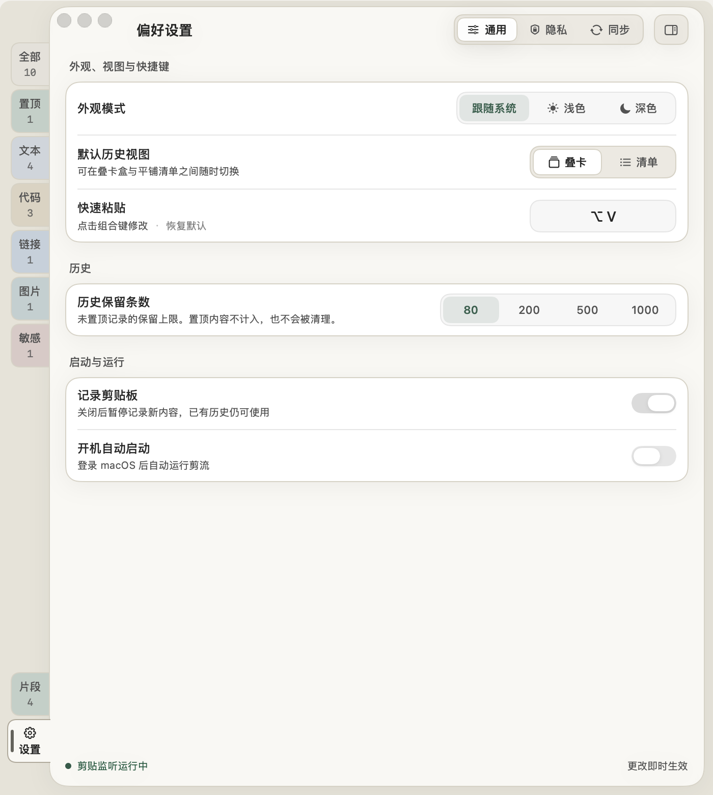

  
  <h1>ClipFlow 剪流</h1>
  
<strong>温润陶纸叠卡匣 · 复制过的内容，随时找回。</strong>

  
原生 macOS 剪贴板与灵感归档工具，融合陶纸活页叠卡盒、120Hz 物理动效、扇形快捷粘贴、表格网格与常用片段。

  

    <a href="https://github.com/FOREST227/ClipFlow/releases/latest">下载最新版</a>
    · <a href="docs/releases/v0.3.2.md">v0.3.2 更新说明</a>
    · <a href="https://github.com/FOREST227/ClipFlow/issues">反馈问题</a>
  

  
macOS 12+ · Apple 芯片 / Intel / 通用版本 · 中文界面 · 本地优先存储

  
  

陶纸暖麻浅色模式 · 温润暖墨深色模式

## 复制之后，不用再找一遍

- **陶纸活页叠卡盒与平铺清单双模式**：主窗口采用温润陶纸与青瓷绿语义点缀设计，左侧书口折签一键筛选「全部 / 置顶 / 文本 / 代码 / 链接 / 图片 / 敏感」及「片段 / 设置」。顶栏可随时切换 **「叠卡 / 清单」** 视图：叠卡模式下鼠标悬停后排纸卡即可就地向上抽出预览，右侧 **时间刻度盘（Time Dial）** 支持无级拖曳拨动与实时顺位气泡，右上角可一键贴边收起为屏幕右侧书签耳；基于 `CVDisplayLink` 实现 120Hz 原生丝滑滚轮弹簧动效。
- **5 卡扇形悬浮快速粘贴**：默认按 `⌥ Option + V` 在鼠标附近呼出无边框 **5 卡扇形悬浮轮播**。支持触控板连续横向/纵向滑动、直接盲打字符唤出顶部悬浮搜索胶囊、单击卡片或按 `↩` 粘贴、`⇧↩` 按纯文本粘贴、`⌘1`–`⌘9` 直贴对应条目。
- **顺序粘贴栈（Paste Stack）**：将多张卡片依次入栈排号，主窗口顶栏与快速粘贴顶部均会浮现待贴队列胶囊，点击「粘贴下一条 `↩`」即可按入栈顺序逐条出栈粘贴，适合跨窗口填表与多段资料整理。
- **电子表格网格预览与 Excel 单元格插入**：从 Excel、Numbers 或 WPS 复制的单元格会完整保留原始剪贴板类型，并在卡片与详情中直接渲染为表格网格（Excel 附带的预览图不会重复记为图片）。在 Excel 中工作时支持向下或向右移动单元格直接插入原格式表格，文本型数字、日期与时间保持原样。
- **常用片段，独立长久留存**：书口「片段」折签专门保存地址、邮件签名、常用回复与代码模板，支持搜索、新建、编辑与排序，也可从任意历史卡片直接「存为片段」。历史条数裁剪与敏感内容过期均不会清理常用片段。
- **代码高亮、Markdown 排版与图片无极缩放**：内置离线语法高亮与后台预热引擎（展开详情零白闪），支持手动指定语言；Markdown 提供「源码 / 预览」胶囊切换；图片详情支持滚轮与双指捏合缩放、拖拽平移查看局部及双击复位。
- **隐私保护与可控历史上限**：默认保留最近 `80` 条未置顶记录，可在「设置 → 通用」切换为 `80 / 200 / 500 / 1000` 条（置顶内容不计入上限，调低前会明确提示将清理的条数）。支持自动遮罩疑似敏感内容、默认 5 分钟自动销毁、Bundle ID 排除规则（系统钥匙串与主流密码管理器始终排除）以及可选的「文稿/ClipFlow」同步。

> 代码高亮与 Markdown 预览完全离线运行，不会执行复制的代码。带有富文本或 HTML 的记录可随时选择「粘贴为纯文本」或「复制为纯文本」（快捷键 `⇧↩`），仅输出干净纯文本。受保护敏感记录仅保存在本机并遮罩正文，不参与文稿目录同步。

## 界面一览

以下截图均由 `v0.3.1` 真实应用视图与演示数据直接渲染生成，不包含任何个人剪贴历史。

### 5 卡扇形悬浮轮播与菜单栏

按下 `⌥ Option + V` 在鼠标指针处即刻展开无边框 5 卡扇形悬浮轮播，顶部集成顺序粘贴待贴胶囊（盲打即搜时切换为悬浮搜索框），底部仅保留搜索、分页指示与打开活页夹三枚轻量化浮钮；菜单栏面板集中呈现监听状态、最近记录与核心隐私开关。

  

  

5 卡扇形悬浮快速粘贴 · 菜单栏概览

### 平铺清单（含表格网格）与常用片段

除默认叠卡盒外，主窗口顶栏可一键切换为「清单」平铺视图，直观展示代码块、自适应比例缩略图、敏感倒计时与电子表格网格；点击左下角「片段」书口折签即可管理永久保留的常用文本模板。

  
  

平铺清单与表格网格 · 常用片段管理

### 抽屉详情：代码高亮、Markdown 预览与图片缩放

双击卡片或按空格即可展开详情抽屉。代码块支持 PowerShell、Bash、Swift、Python、JavaScript、TypeScript、C / C++、C#、Java、Go、Rust、SQL、JSON、YAML、HTML、CSS 等常见语言高亮；Markdown 支持胶囊切换源码与排版预览；图片画布支持无极缩放与拖拽查看；底部动作栏聚合粘贴、复制与更多操作菜单（纯文本粘贴/复制、置顶、存为片段、插入到 Excel、删除）。

  
  

  

代码详情 · Markdown 预览 · 图片缩放画布

### 偏好设置

按「通用 / 隐私 / 同步」分组管理：通用页支持切换外观模式、默认历史视图（叠卡 / 清单）、快速粘贴快捷键以及未置顶历史保留条数（`80 / 200 / 500 / 1000`）。

  

## 下载与安装

前往 **[最新版本](https://github.com/FOREST227/ClipFlow/releases/latest)**，展开 **Assets** 下载 `.dmg`：

| 你的 Mac | 安装包 |
| --- | --- |
| Apple 芯片 | [ClipFlow-v0.3.2-arm64.dmg](https://github.com/FOREST227/ClipFlow/releases/download/v0.3.2/ClipFlow-v0.3.2-arm64.dmg) |
| Intel 处理器 | [ClipFlow-v0.3.2-x86_64.dmg](https://github.com/FOREST227/ClipFlow/releases/download/v0.3.2/ClipFlow-v0.3.2-x86_64.dmg) |
| 两种架构通用，或不确定芯片类型 | [ClipFlow-v0.3.2-universal.dmg](https://github.com/FOREST227/ClipFlow/releases/download/v0.3.2/ClipFlow-v0.3.2-universal.dmg) |

1. 打开 `.dmg`，将 **ClipFlow** 拖入“应用程序”。
2. 从“应用程序”启动，点击菜单栏中的 ClipFlow 图标。
3. 首次自动粘贴时再授予“辅助功能”权限。未授权时内容仍会写回剪贴板，可在目标应用按 `⌘V` 手动粘贴。

应用启动后驻留菜单栏，不自动弹出主窗口，也不占用程序坞图标。安装包旁的 `.sha256` 文件用于完整性校验，日常安装只需下载 `.dmg`。

**首次打开与权限：** 发布包尚未经过 Apple 公证，系统可能提示无法验证开发者。确认下载自本仓库后，可在系统“隐私与安全性”中允许打开。版本更新或签名变化后，可能需要重新授予辅助功能权限。

## 怎样使用

| 操作 | 结果 |
| --- | --- |
| 复制文本、代码、表格、链接或图片 | 自动归入活页叠卡历史 |
| `⌥ Option + V` | 在鼠标附近呼出无边框 5 卡扇形悬浮快速粘贴（可在设置修改快捷键） |
| 在扇形轮播中直接打字，或按 `⌘F` | 唤出顶部悬浮搜索胶囊实时过滤卡片 |
| 在扇形轮播按 `←` / `→` / `↑` / `↓` 或双指滑动 | 丝滑轮换焦点卡片 |
| 在扇形轮播单击卡片，或按 `↩` | 粘贴到此前使用的前台应用 |
| 在扇形轮播按 `⇧↩` | 剥离富文本样式，按纯文本粘贴选中条目 |
| 在扇形轮播或主窗口按 `⌘1`–`⌘9` | 直接粘贴对应顺位的条目 |
| 主窗口顶栏「叠卡 / 清单」 | 在 3D 阶梯叠卡盒与平铺清单之间切换 |
| 叠卡模式下悬停后排纸卡 / 拖动右侧时间刻度盘 | 原槽向上抽出偷看内容 / 按时间轴无级翻阅全部卡片 |
| 点击卡片「`+`」加入顺序粘贴 | 将多张卡片排入待贴队列，按序逐条出栈粘贴 |
| 主窗口右上角侧栏收起按钮 | 将活页夹贴边收起为屏幕右侧悬浮书签耳，点击即刻展开 |
| 主窗口按 `⌘F`（或菜单「编辑 → 查找」） | 打开剪贴历史并将光标移入搜索框；按 `Esc` 先清空搜索词，再按关闭详情 |
| 双击主窗口卡片，或在任意面板按 `空格` | 展开选中条目的抽屉详情（代码高亮 / Markdown 预览 / 表格网格 / 图片缩放） |
| 右键点击卡片或点击详情「`…`」 | 查看全部操作：粘贴为纯文本、复制为纯文本、置顶、存为片段、插入到 Excel、删除等 |
| 左侧书口「片段」折签 | 搜索、新建、编辑、排序常用片段（删除前二次确认） |
| 「设置 → 通用」中的历史保留条数 | 在 `80 / 200 / 500 / 1000` 之间选择未置顶记录上限，调低前确认删除条数 |

## 隐私与保存

历史默认保存在本机。你可以随时暂停「记录剪贴板」，或通过应用 Bundle ID 排除不希望记录的软件。

敏感内容自动识别是一项辅助功能，**不保证识别所有私密信息**。被保护的记录会遮罩显示、仅本地保存，不参与文稿目录同步。

**敏感内容 5 分钟自动过期默认开启：**

- 从复制时间开始计时，置顶也不会延长保留时间。
- 关闭自动过期后，仍保留遮罩显示与仅本地保存规则。
- 重新开启时，会立即清理已经超过 5 分钟的敏感记录。
- 常用片段不参与自动过期；从敏感记录保存的片段需先确认，之后以明文仅留在本机。

### 可选的文稿目录同步

开启后，普通历史和常用片段写入 **文稿/ClipFlow**。从敏感记录保存的片段只留在本机。菜单栏与设置页会显示「未同步 / 同步中 / 已同步 / 同步失败」，开关单独控制是否启用。

跨 Mac 同步依赖系统 iCloud Drive 的“桌面与文稿文件夹”同步，以及其他设备上的相同设置；ClipFlow 没有独立的云端账户服务。“已同步”表示应用已完成本机文稿目录写入，不代表 iCloud 已传播到所有设备。

## 兼容性与反馈

最低支持 macOS 12，提供 Apple 芯片、Intel 与 Universal 安装包。macOS 12 的开机启动需在系统“用户与群组 → 登录项”中手动添加；macOS 13 及以上可在应用内直接管理。

遇到问题欢迎 [提交 Issue](https://github.com/FOREST227/ClipFlow/issues)，附上 macOS 版本、芯片型号、应用版本及复现步骤。分享截图前请遮住私人剪贴内容。

- [v0.3.2 更新说明](docs/releases/v0.3.2.md)
- [开发、测试与打包](docs/development.md)
- [离线渲染组件与许可证](Sources/ClipFlowApp/Renderer/NOTICE.txt)

## 许可证

ClipFlow 以 GNU General Public License v3.0 或更高版本发布（[GPL-3.0-or-later](LICENSE)）。版权所有 © 2026 FOREST227。

---

  
   ClipFlow 剪流 · 让每一次复制都更有用

