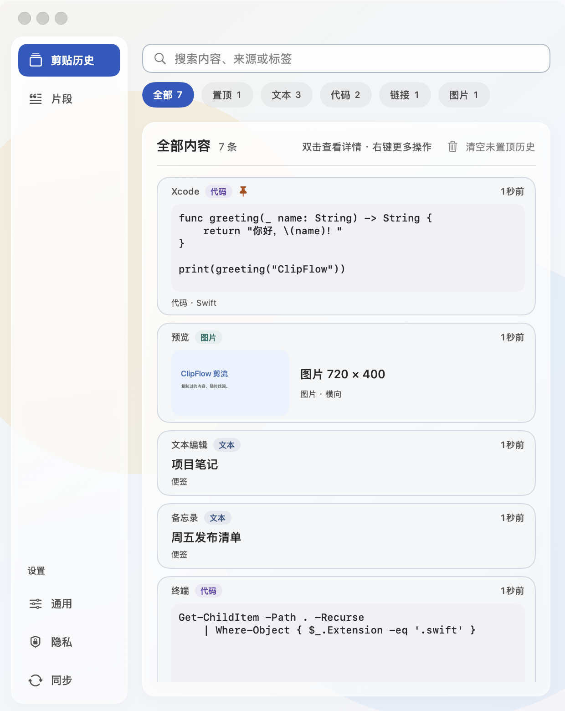
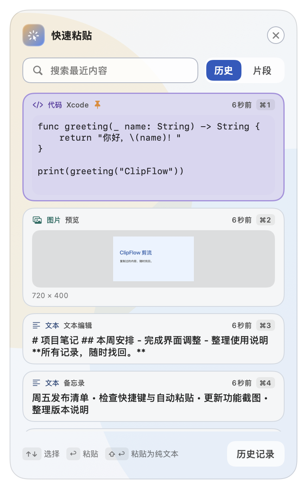
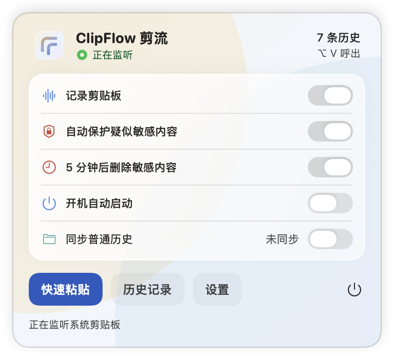
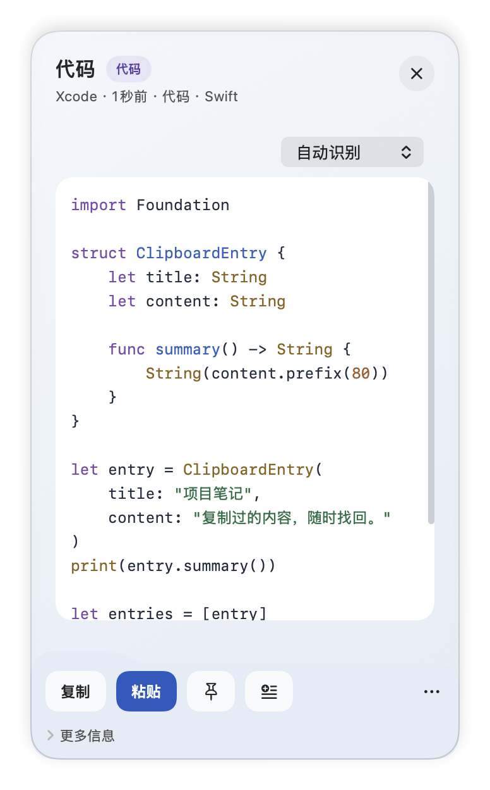
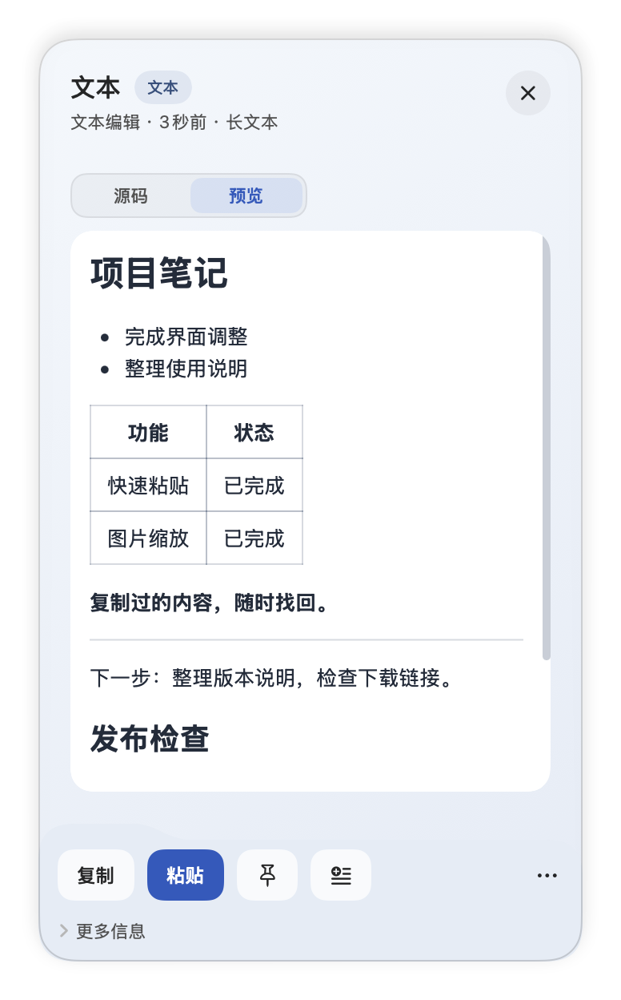
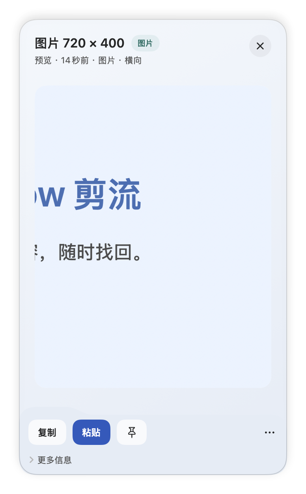
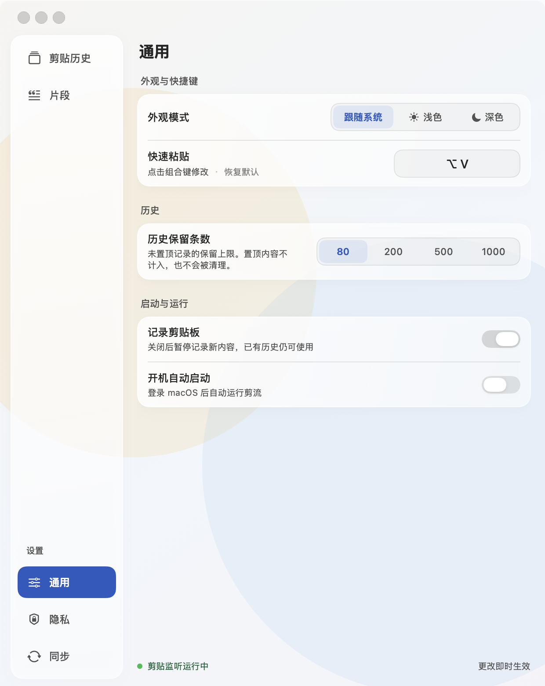

  
  <h1>ClipFlow 剪流</h1>
  
<strong>复制过的内容，随时找回。</strong>

  
一款轻量的原生 macOS 剪贴板工具，集中管理文本、代码、链接、图片和常用片段。

  

    <a href="https://github.com/FOREST227/ClipFlow/releases/latest">下载最新版</a>
    · <a href="docs/releases/v0.2.1.md">v0.2.1 更新说明</a>
    · <a href="https://github.com/FOREST227/ClipFlow/issues">反馈问题</a>
  

  
macOS 12+ · Apple 芯片 / Intel / 通用版本 · 中文界面 · 本地保存

  

## 复制之后，不用再找一遍

- **随手呼出，快速粘贴**：默认按 <code>⌥ Option + V</code> 在鼠标附近打开面板。单击选中、双击粘贴；也可以全程用键盘：<code>↑</code> <code>↓</code> 选择、<code>↩</code> 粘贴、<code>⇧↩</code> 按纯文本粘贴、<code>⌘1</code>–<code>⌘9</code> 直接粘贴对应条目。面板可在「历史 / 片段」之间切换。底部一行放着选择、粘贴、粘贴为纯文本和「历史记录」；鼠标移到底部，会再看到 ⌘1–9，以及空格详情或 ⌃←→ 切换。右上角是圆形关闭按钮，按 Esc 同样关闭。
- **一眼分清内容**：文本蓝、代码紫、链接靛青、图片青绿、敏感内容红。默认保存最近 80 条未置顶历史，可在「设置 → 通用」改为 200、500 或 1000 条。置顶内容不计入上限，也不会被清理；调低后若会删掉未置顶记录，会先说明将删除多少条最早的记录。可按“全部 / 置顶 / 文本 / 代码 / 链接 / 图片 / 敏感”筛选。条数为 0 的标签不显示，「全部」和正在查看的那一个除外。图片卡片只到缩略图那么高，代码卡片仍留出五行预览。主窗口按 <code>⌘F</code> 把光标放进搜索框，并按内容、来源和标签搜索。受保护记录只按标题、来源和标签匹配，不按正文搜索。
- **常用片段，不会被历史清掉**：地址、签名、常用回复和代码模板保存在侧栏「片段」里，可以搜索、新建、编辑、调整顺序和删除。每一行用和历史相同的卡片，分类留在标题旁，不再重复「片段」标记。历史和详情里可以「存为片段」。历史条数和敏感内容过期都不会删除它们。已标记为敏感的历史需确认后才会以明文保存，并只留在本机。
- **就地操作，按需展开详情**：鼠标悬停历史卡片即可复制、置顶或删除，右键菜单提供全部操作；双击或按空格从条目位置展开抽屉，内容与操作分层呈现。
- **代码与 Markdown，都能好好读**：常见语言语法高亮，支持手动指定语言；Markdown 用和设置相同的胶囊控件切换源码与排版预览。
- **图片不只是一张缩略图**：详情按可用高度铺满，支持滚轮与双指捏合缩放、拖动查看局部；向外捏合仍能看到整张图，双击恢复完整显示。尺寸写在标题里，预览上不再重复一遍。
- **状态与隐私，清楚可控**：菜单栏和设置共用开关名称。打开「记录剪贴板」才会记下新内容；可排除应用、自动保护疑似敏感内容、5 分钟后删除敏感内容，并单独控制「同步普通历史」。

> 代码高亮与 Markdown 预览离线可用，不会执行复制的代码。复制、粘贴保留原始文本及其缩进、换行，并在再次粘贴或复制回剪贴板时恢复当时的富文本、HTML 和文件链接。从 Excel、Numbers 或 WPS 复制的单元格会按表格保存，并在详情、历史列表和快速粘贴里显示成网格。普通文本仍按文本显示。Excel 随后只留下预览图时，不会再记成另一条图片；粘贴回去仍是带格式的单元格，文本格式的数字保持文本，日期和时间保持原格式。带有富文本或 HTML 的记录，可以改为「粘贴为纯文本」或「复制为纯文本」，只留下原来的文字。已经是纯文本的记录、只有文件链接的复制，以及图片，不提供这两项。分类和语法识别仍可能有误，可通过语言选择调整显示。

## 界面一览

以下主窗口与 v0.1.6 相同，截图仍由当时的真实应用组件生成。表格网格，以及右键菜单和详情里的表格操作，这些图没有展示。全部使用演示数据，不包含个人剪贴历史。图片外部的白色留白仅用于文档展示。

### 快速粘贴与菜单栏

快捷面板专注搜索、选中与粘贴，并可在历史和常用片段之间切换。底部提示收在一行，右上角用圆形按钮关闭。菜单栏专注运行状态和关键开关，记录开关写着「记录剪贴板」。两者分工明确，不重复堆放历史列表。

  
  

快速粘贴 · 菜单栏概览

### 常用片段

主窗口「片段」单独保存可反复粘贴的文字。这些内容不进入剪贴历史，也不会随历史条数或敏感内容过期被清掉。列表用和历史相同的卡片，分类留在标题旁。

  

### 抽屉详情：代码与 Markdown

展开详情后，正文保持独立阅读区域，底部抽屉集中放置来源摘要和操作。两张详情卡片按相同尺寸并排展示，正文、来源摘要和底部操作一目了然。文本详情可以「存为片段」。Markdown 用胶囊控件切换源码与预览。

高亮支持 PowerShell、Bash、Swift、Python、JavaScript、TypeScript、C / C++、C#、Java、Go、Rust、SQL、JSON、YAML、HTML、CSS 等常见语言。自动识别不准确时，可在详情中手动指定语言。

  
  

代码详情 · Markdown 预览

### 图片详情

图片在独立画布中查看，并按可用高度铺满：滚轮或双指捏合缩放，放大后可拖动查看局部；向外捏合仍能看到整张图，双击恢复完整显示。尺寸写在标题里。图片没有纯文本，也不能存为片段。

  

### 设置

按「通用 / 隐私 / 同步」分组管理选项。通用页可以选择历史保留条数（80、200、500、1000），并修改外观、快捷键和运行方式。「记录剪贴板」与菜单栏使用同一名称。排除应用规则需点击保存。

  

## 下载与安装

前往 **[最新版本](https://github.com/FOREST227/ClipFlow/releases/latest)**，展开 **Assets** 下载 .dmg：

| 你的 Mac | 安装包 |
| --- | --- |
| Apple 芯片 | [ClipFlow-v0.2.1-arm64.dmg](https://github.com/FOREST227/ClipFlow/releases/download/v0.2.1/ClipFlow-v0.2.1-arm64.dmg) |
| Intel 处理器 | [ClipFlow-v0.2.1-x86_64.dmg](https://github.com/FOREST227/ClipFlow/releases/download/v0.2.1/ClipFlow-v0.2.1-x86_64.dmg) |
| 两种架构通用，或不确定芯片类型 | [ClipFlow-v0.2.1-universal.dmg](https://github.com/FOREST227/ClipFlow/releases/download/v0.2.1/ClipFlow-v0.2.1-universal.dmg) |

1. 打开 .dmg，将 **ClipFlow** 拖入“应用程序”。
2. 从“应用程序”启动，点击菜单栏中的 ClipFlow 图标。
3. 首次自动粘贴时再授予“辅助功能”权限。未授权时内容留在剪贴板，可在目标应用按 ⌘V。

应用启动后驻留菜单栏，不自动弹出主窗口，也不显示程序坞图标。安装包旁的 .sha256 文件用于校验，正常安装只需下载 .dmg。

**首次打开与权限：** 发布包尚未经过 Apple 公证，系统可能提示无法验证开发者。确认下载自本仓库后，可在系统“隐私与安全性”中允许打开。版本更新或签名变化后，可能需要重新授予辅助功能权限。

## 怎样使用

| 操作 | 结果 |
| --- | --- |
| 复制文本、代码、链接或图片 | 自动记录到历史 |
| ⌥ Option + V | 打开快速粘贴面板；可在设置中修改快捷键 |
| ⌘F，或菜单「编辑 → 查找」 | 打开剪贴历史，并把光标放进搜索框 |
| 在历史搜索框按 Esc | 先清除已输入的搜索词；再按一次关闭详情 |
| 单击卡片 | 仅选中，不修改系统剪贴板 |
| 在快速粘贴面板双击卡片，或按 ↩ | 粘贴到此前使用的应用 |
| 在快速粘贴面板按 ↑ / ↓ | 切换选中的条目 |
| 在快速粘贴面板按 ⇧↩，或按住 Shift 双击 | 按纯文本粘贴选中条目；图片没有纯文本 |
| 在快速粘贴面板或历史页按 ⌘1–⌘9 | 直接粘贴对应位置的条目 |
| 在快速粘贴面板按 ⌃← / ⌃→ | 在历史和常用片段之间切换 |
| 在历史页双击卡片；历史页和快速粘贴面板均可按空格 | 打开选中条目的详情 |
| 在历史页悬停卡片 | 显示复制、置顶、删除按钮 |
| 右键点击卡片 | 打开操作菜单：查看详情、粘贴、复制、置顶、删除等。带有富文本或 HTML 时还有粘贴为纯文本、复制为纯文本；有文字时可以存为片段 |
| 详情中的“复制 / 粘贴 / 图钉” | 复制原文、直接粘贴或置顶。文本详情还可以存为片段 |
| 图片详情中滚轮 / 双指捏合 | 放大缩小；放大后拖动查看，双击恢复 |
| 历史页“清空未置顶历史” | 确认后删除未置顶记录，保留置顶记录 |
| 侧栏「片段」 | 搜索、新建、编辑、排序常用片段；删除前会确认 |
| 「设置 → 通用」中的历史保留条数 | 在 80、200、500、1000 之间选择未置顶记录的上限。调低前需确认才会删除 |

未授予辅助功能权限时，仍可保存历史。自动粘贴会改为把内容放回剪贴板，也可在详情中点击“复制”，然后手动使用 ⌘ Command + V。

## 隐私与保存

历史默认保存在本机。你可以暂停监听，或通过应用 Bundle ID 排除不希望记录的软件。

敏感内容自动识别是一项辅助功能，**不保证识别所有私密信息**。被保护的记录会遮罩显示、仅本地保存，不参与文稿目录同步。

**敏感内容 5 分钟自动过期默认开启：**

- 从复制时间开始计时，置顶也不会延长保留时间。
- 关闭自动过期后，仍保留遮罩显示与仅本地保存规则。
- 重新开启时，会清理已经超过 5 分钟的敏感记录。
- 常用片段不参与这次过期。从敏感记录保存的片段需先确认，之后以明文留在本机。

### 可选的文稿目录同步

开启后，普通历史和常用片段写入 **文稿/ClipFlow**。从敏感记录保存的片段只留在本机。片段写入失败不会关掉历史同步。菜单栏会显示「未同步 / 同步中 / 已同步 / 同步失败」，开关单独控制是否启用。

跨 Mac 同步依赖系统 iCloud Drive 的“桌面与文稿文件夹”同步，以及其他设备上的相同设置；ClipFlow 没有独立的云端账户服务。“已同步”表示应用已完成文稿目录写入，不代表 iCloud 已传播到所有设备。同步目录中的旧图片可能继续保留，不会随本机清理而全部删除。

## 兼容性与反馈

最低支持 macOS 12，提供 Apple 芯片、Intel 与 Universal 安装包。macOS 12 的开机启动需在系统“用户与群组 → 登录项”中手动添加；macOS 13 及以上可在应用内管理。

构建目标覆盖 macOS 12，但旧系统实机与 Intel 实机仍需要更多验证。遇到问题，欢迎 [提交 Issue](https://github.com/FOREST227/ClipFlow/issues)，附上 macOS 版本、芯片型号、应用版本及复现步骤。分享截图前请遮住私人剪贴内容。

- [更新说明](docs/releases/v0.2.1.md)
- [开发、测试与打包](docs/development.md)
- [离线渲染组件与许可证](Sources/ClipFlowApp/Renderer/NOTICE.txt)

## 许可证

ClipFlow 以 GNU General Public License v3.0 或更高版本发布（[GPL-3.0-or-later](LICENSE)）。版权所有 © 2026 FOREST227。

---

  
   ClipFlow 剪流 · 让每一次复制都更有用

