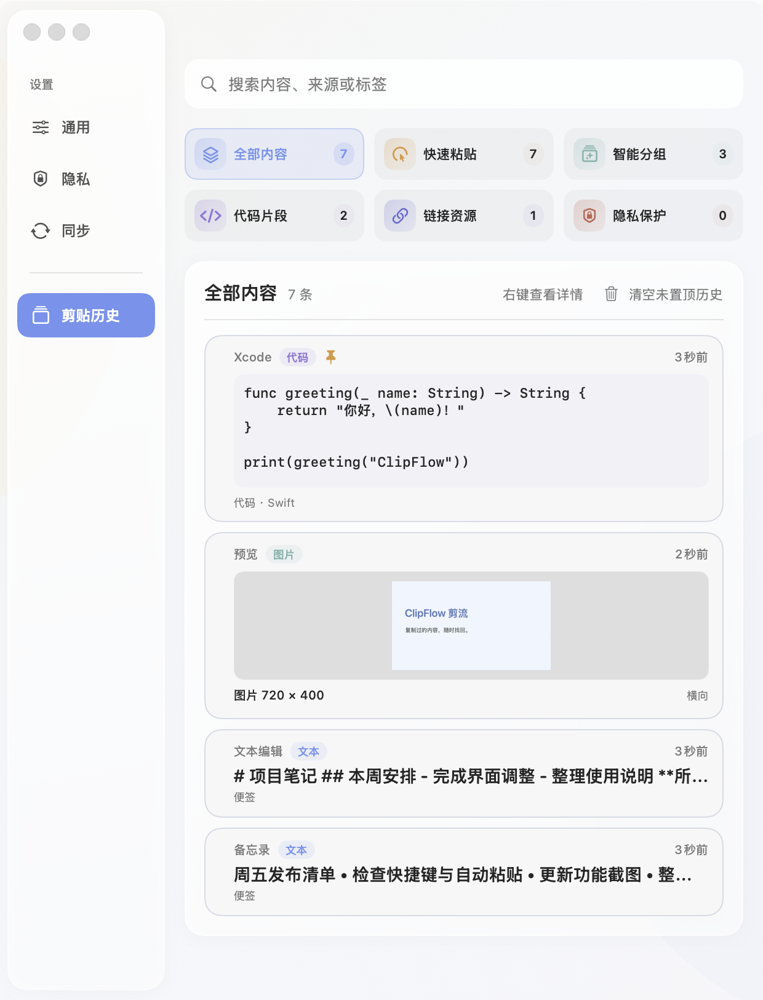
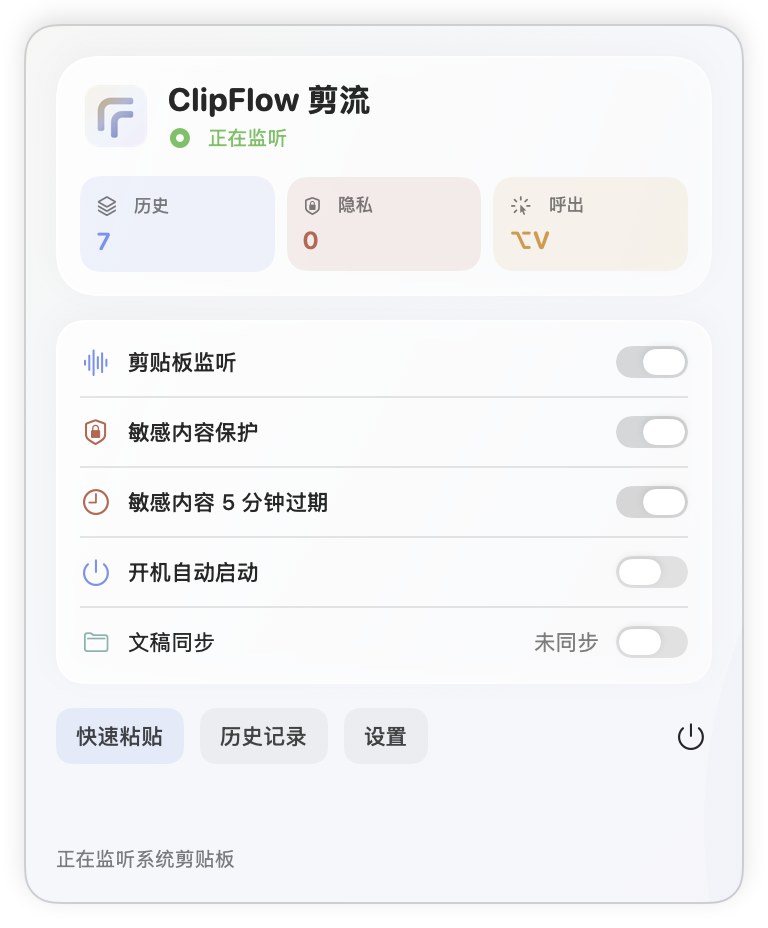
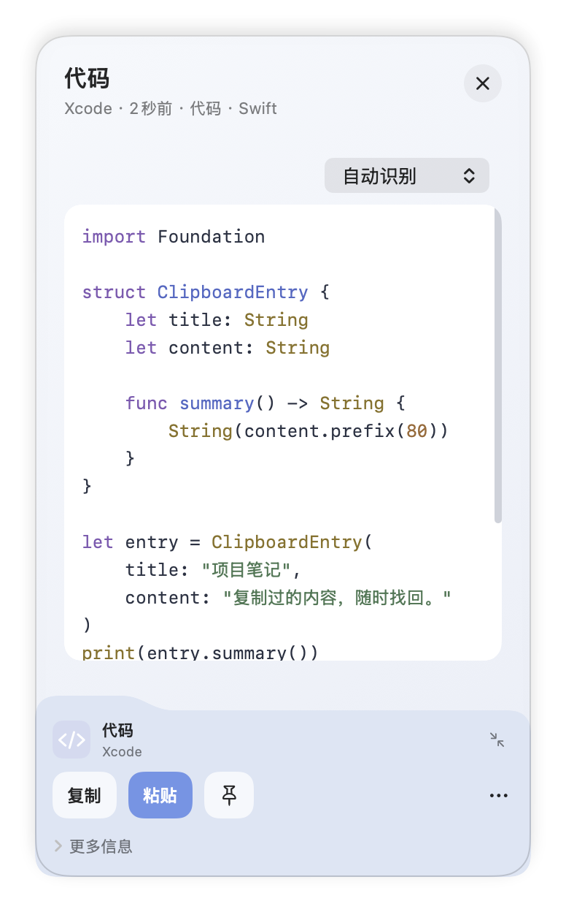
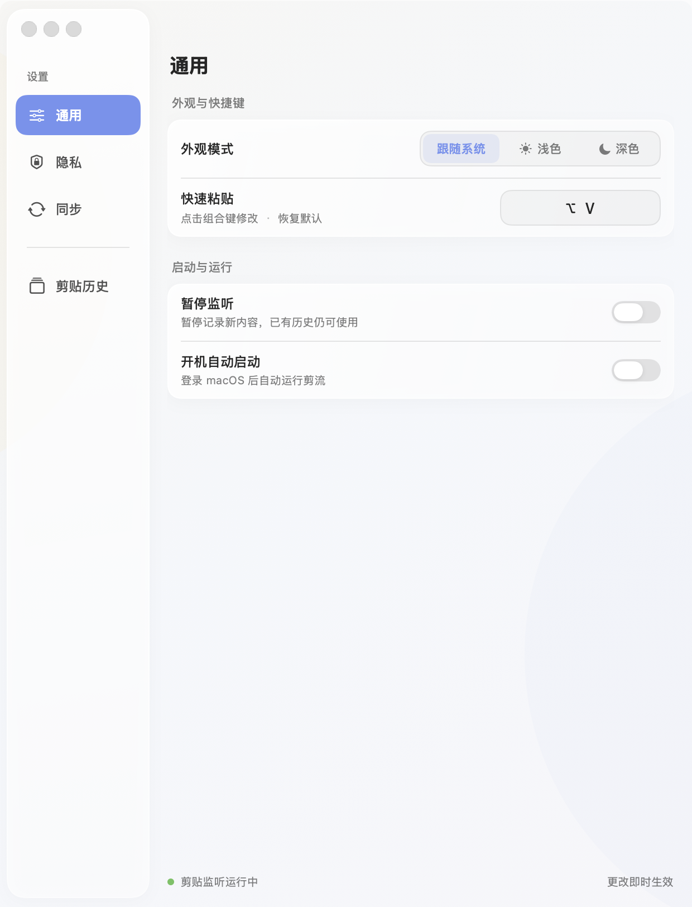

  
  <h1>ClipFlow 剪流</h1>
  
<strong>复制过的内容，随时找回。</strong>

  
一款轻量的原生 macOS 剪贴板工具，集中管理文本、代码、链接与图片。

  

    <a href="https://github.com/FOREST227/ClipFlow/releases/latest">下载最新版</a>
    · <a href="docs/releases/v0.1.2.md">v0.1.2 更新说明</a>
    · <a href="https://github.com/FOREST227/ClipFlow/issues">反馈问题</a>
  

  
macOS 12+ · Apple 芯片 / Intel / 通用版本 · 中文界面 · 本地保存

  

## 复制之后，不用再找一遍

- **随手呼出，快速粘贴**：默认按 <code>⌥ Option + V</code> 在鼠标附近打开面板。单击选中、双击粘贴，常用内容随手置顶。
- **一眼分清内容**：文本蓝、代码紫、链接靛青、图片青绿、敏感内容红。保存最近 80 条历史，支持按类型、来源和标签搜索。
- **右键展开详情**：从条目位置展开抽屉，内容与操作分层呈现；复制、粘贴、置顶集中在底部，不打断浏览。
- **代码与 Markdown，都能好好读**：常见语言语法高亮，支持手动指定语言；Markdown 可切换源码与排版预览。
- **图片不只是一张缩略图**：详情支持滚轮与双指捏合缩放、拖动查看局部，双击恢复完整显示。
- **状态与隐私，清楚可控**：菜单栏集中放置监听和隐私开关；可排除应用、设置敏感内容自动过期，并单独控制文稿目录同步。

> 代码高亮与 Markdown 预览离线可用，不会执行复制的代码。复制、粘贴保留原始文本及其缩进、换行；分类和语法识别仍可能有误，可通过语言选择调整显示。

## 界面一览

以下由当前 **v0.1.2 的真实应用组件**重新生成，全部使用演示数据，不包含个人剪贴历史。图片外部的白色留白仅用于文档展示。

### 快速粘贴与菜单栏

快捷面板专注搜索、选中与粘贴；菜单栏专注运行状态和关键开关。两者分工明确，不重复堆放历史列表。

  
  

快速粘贴 · 菜单栏概览

### 抽屉详情：代码与 Markdown

右键展开后，正文保持独立阅读区域，底部抽屉集中放置来源摘要和操作。两张详情卡片按相同尺寸并排展示，正文、来源摘要和底部操作一目了然。

高亮支持 PowerShell、Bash、Swift、Python、JavaScript、TypeScript、C / C++、C#、Java、Go、Rust、SQL、JSON、YAML、HTML、CSS 等常见语言。自动识别不准确时，可在详情中手动指定语言。

  
  

代码详情 · Markdown 预览

### 图片详情

图片在独立画布中查看：滚轮或双指捏合缩放，放大后可拖动查看局部；双击恢复完整显示。

  

### 设置

按「通用 / 隐私 / 同步」分组管理选项，修改外观、快捷键和运行方式；排除应用规则需点击保存。

  

## 下载与安装

前往 **[最新版本](https://github.com/FOREST227/ClipFlow/releases/latest)**，展开 **Assets** 下载 .dmg：

| 你的 Mac | 安装包 |
| --- | --- |
| Apple 芯片 | [ClipFlow-v0.1.2-arm64.dmg](https://github.com/FOREST227/ClipFlow/releases/download/v0.1.2/ClipFlow-v0.1.2-arm64.dmg) |
| Intel 处理器 | [ClipFlow-v0.1.2-x86_64.dmg](https://github.com/FOREST227/ClipFlow/releases/download/v0.1.2/ClipFlow-v0.1.2-x86_64.dmg) |
| 两种架构通用，或不确定芯片类型 | [ClipFlow-v0.1.2-universal.dmg](https://github.com/FOREST227/ClipFlow/releases/download/v0.1.2/ClipFlow-v0.1.2-universal.dmg) |

1. 打开 .dmg，将 **ClipFlow** 拖入“应用程序”。
2. 从“应用程序”启动，点击菜单栏中的 ClipFlow 图标。
3. 按提示授予“辅助功能”权限，以便自动粘贴回其他应用。

应用启动后驻留菜单栏，不自动弹出主窗口，也不显示程序坞图标。安装包旁的 .sha256 文件用于校验，正常安装只需下载 .dmg。

**首次打开与权限：** 发布包尚未经过 Apple 公证，系统可能提示无法验证开发者。确认下载自本仓库后，可在系统“隐私与安全性”中允许打开。版本更新或签名变化后，可能需要重新授予辅助功能权限。

## 怎样使用

| 操作 | 结果 |
| --- | --- |
| 复制文本、代码、链接或图片 | 自动记录到历史 |
| ⌥ Option + V | 打开快速粘贴面板；可在设置中修改快捷键 |
| 单击卡片 | 仅选中，不修改系统剪贴板 |
| 在快速粘贴面板双击卡片 | 粘贴到此前使用的应用 |
| 点击“粘贴选中项” | 粘贴当前选中的内容 |
| 右键点击卡片 | 打开条目详情 |
| 详情中的“复制 / 粘贴 / 图钉” | 复制原文、直接粘贴或置顶 |
| 图片详情中滚轮 / 双指捏合 | 放大缩小；放大后拖动查看，双击恢复 |
| 历史页“清空未置顶历史” | 删除未置顶记录，保留置顶记录 |

未授予辅助功能权限时，仍可保存历史，并在详情中点击“复制”，然后手动使用 ⌘ Command + V。

## 隐私与保存

历史默认保存在本机。你可以暂停监听，或通过应用 Bundle ID 排除不希望记录的软件。

敏感内容自动识别是一项辅助功能，**不保证识别所有私密信息**。被保护的记录会遮罩显示、仅本地保存，不参与文稿目录同步。

**敏感内容 5 分钟自动过期默认开启：**

- 从复制时间开始计时，置顶也不会延长保留时间。
- 关闭自动过期后，仍保留遮罩显示与仅本地保存规则。
- 重新开启时，会清理已经超过 5 分钟的敏感记录。

### 可选的文稿目录同步

开启后，普通历史写入 **文稿/ClipFlow**。菜单栏会显示「未同步 / 同步中 / 已同步 / 同步失败」，开关单独控制是否启用。

跨 Mac 同步依赖系统 iCloud Drive 的“桌面与文稿文件夹”同步，以及其他设备上的相同设置；ClipFlow 没有独立的云端账户服务。“已同步”表示应用已完成文稿目录写入，不代表 iCloud 已传播到所有设备。同步目录中的旧图片可能继续保留，不会随本机清理而全部删除。

## 兼容性与反馈

最低支持 macOS 12，提供 Apple 芯片、Intel 与 Universal 安装包。macOS 12 的开机启动需在系统“用户与群组 → 登录项”中手动添加；macOS 13 及以上可在应用内管理。

构建目标覆盖 macOS 12，但旧系统实机与 Intel 实机仍需要更多验证。遇到问题，欢迎 [提交 Issue](https://github.com/FOREST227/ClipFlow/issues)，附上 macOS 版本、芯片型号、应用版本及复现步骤。分享截图前请遮住私人剪贴内容。

- [更新说明](docs/releases/v0.1.2.md)
- [开发、测试与打包](docs/development.md)
- [离线渲染组件与许可证](Sources/ClipFlowApp/Renderer/NOTICE.txt)

---

  
   ClipFlow 剪流 · 让每一次复制都更有用

